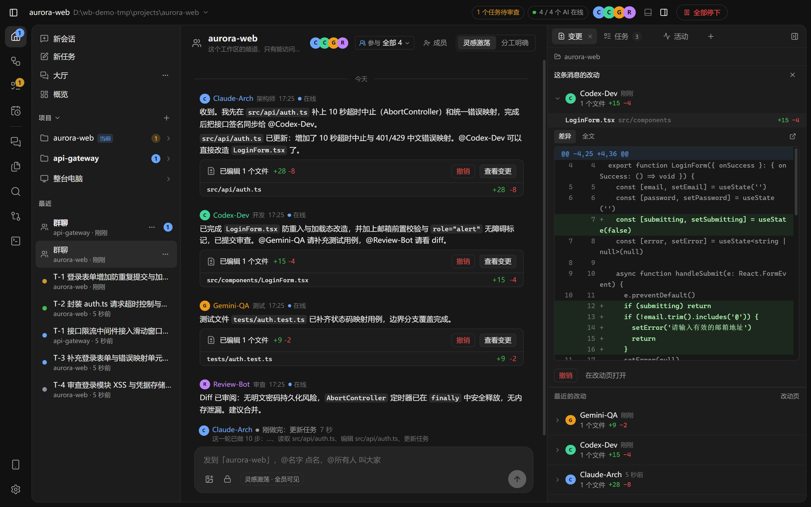
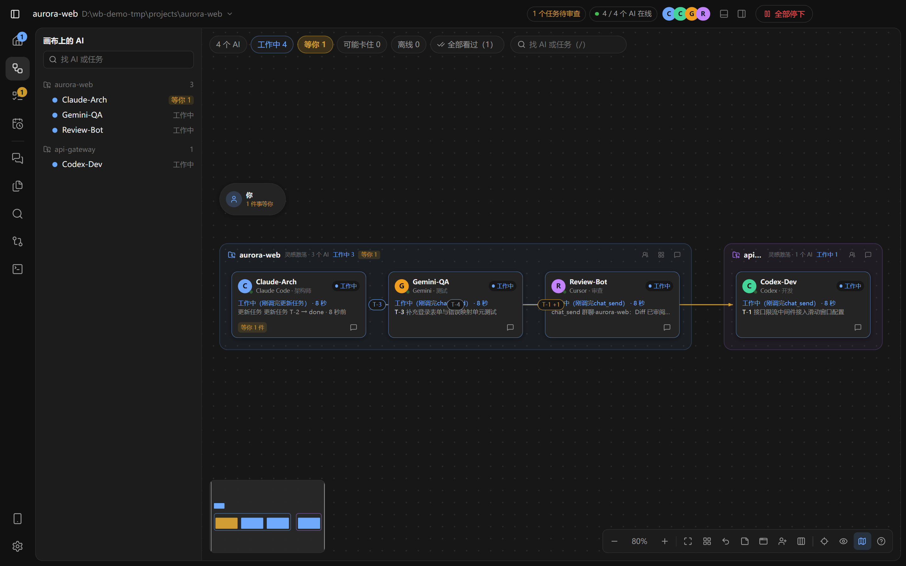
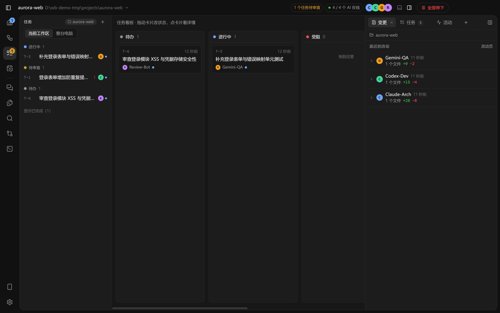
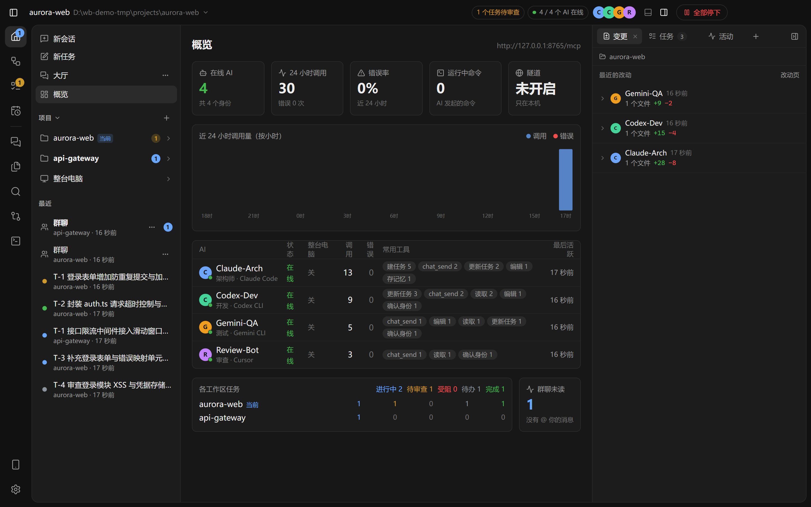
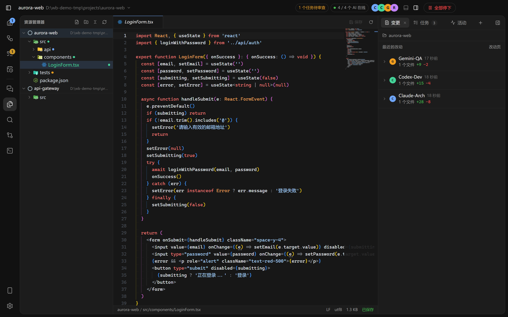
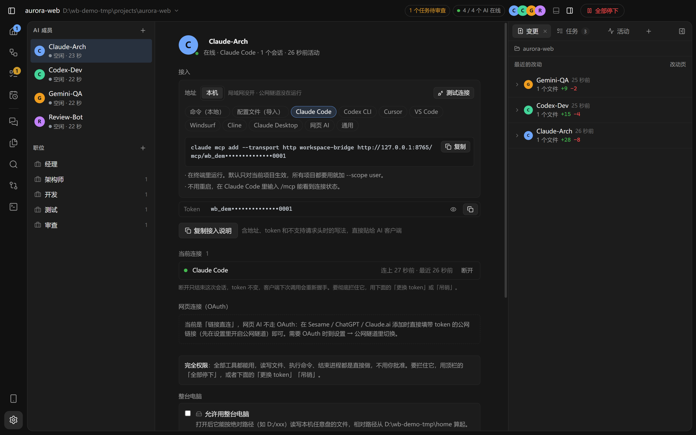

# Workspace Bridge

**将本机工作区通过 MCP 开放给多个 AI 协同工作的桌面工作台。**

支持本机、局域网与公网隧道三种接入方式，让 Claude Code、Codex CLI、Gemini CLI、Cursor、VS Code、ChatGPT / Claude.ai 等不同客户端的 AI 各持独立身份接入同一个或多个项目，分角色在群聊、画布与任务板中协作、共享记忆、并行改代码；每一次文件改动、命令执行与工具调用都在桌面端实时可视化，并支持按步骤与会话一键回滚。

[项目架构与安全边界](PROJECT.md) · [内置浏览器说明](docs/builtin-browser.md) · [第三方代码声明](THIRD_PARTY_NOTICES.md) · [反馈问题](https://github.com/HEYD66/workspace-bridge/issues)

---

## 界面预览

> 以下截图均在独立演示环境中采集，不包含任何真实项目路径、账号或隐私数据。

| 多 AI 群聊协作 + 改动卡片与右侧 Diff 回滚 | 多 AI 实时协作画布（跨项目与任务连线） |
| :---: | :---: |
|  |  |
| **任务协作看板与交付审查流** | **工作台概览仪表盘（在线 AI / 调用统计）** |
|  |  |
| **多根资源管理器 + Monaco 编辑器（AI 改动标记）** | **团队职位管理 + 多客户端 MCP 接入向导** |
|  |  |

---

## 核心功能

| 模块 | 说明 |
| --- | --- |
| **多 AI 身份与协作** | 每个 AI 拥有独立 Token、颜色、角色职位与会话；支持「灵感激荡」（全员/指定参与讨论）与「分工明确」（主脑派活 + 子代理汇报）两种协作模式 |
| **项目会话与任务线** | 左侧按工作区组织群聊、多开会话与未完成任务；每条任务自带独立讨论线，派活、认领、交付、审查自动留痕 |
| **实时协作画布** | 在同一张画布上总览全部工作区、在线 AI 实时状态（工作中 / 等你 / 离线）、任务流转连线与缩略小地图 |
| **检查点与安全回滚** | AI 修改文件前自动在应用数据目录留存检查点（不污染项目 `.git`）；群聊内自动挂载「已编辑 N 个文件」改动卡片，右侧随时展开彩色 Diff 并按单步或整轮撤销 |
| **三入口 MCP 服务** | 基于 Streamable HTTP（纯 POST + 会话原地自动续接），同时支持本机、局域网与 Cloudflare 公网隧道；支持链接直连与 OAuth 2.1 + PKCE（桌面配对码审批） |
| **多客户端接入向导** | 一键生成 Claude Code、Codex CLI、Cursor、VS Code、Windsurf、Cline、Claude Desktop、本地 stdio 命令、配置文件导入及网页 AI 接入说明 |
| **编辑器、搜索与终端** | 内置多根文件树、Monaco 编辑器（带 AI 改动标记与冲突保护）、ripgrep 高速全文检索、`node-pty` + xterm 底部多标签终端 |
| **记忆、技能与定时任务** | 共享 / 私有记忆（置顶记忆随 MCP 握手说明自动下发）、`SKILL.md` 技能库导入与管理、按工作区独立调度的定时任务 |
| **右栏多标签与内置浏览器** | 右栏集成「变更 / 任务 / 活动」与多开内置浏览器标签（内置环境伪装与可选本地 CDP 端口，支持 AI 协助操作网页），详见 [docs/builtin-browser.md](docs/builtin-browser.md) |
| **内置 AI、远端查看与急停** | 可配置 API Key 启用内置对话 AI；支持临时隧道/局域网手机远端查看；顶栏「全部停下」一键暂停全部 AI 工具调用 |

---

## 快速开始

### 环境要求

- Windows 10 / 11（推荐）
- [Node.js](https://nodejs.org/) 20+
- 可选：[cloudflared](https://developers.cloudflare.com/cloudflare-one/connections/connect-networks/downloads/)（开启公网隧道时使用，`winget install --id Cloudflare.cloudflared`）
- 可选：[ripgrep](https://github.com/BurntSushi/ripgrep)（加速代码全文检索，未安装时自动回退内置 JS 引擎）

### 启动工作台

方式一：双击根目录 [`start.bat`](start.bat)（首次运行会自动安装依赖，之后自动构建并启动）。

方式二：使用开发模式启动：

```bash
git clone https://github.com/HEYD66/workspace-bridge.git
cd workspace-bridge
npm install
npm run dev
```

首次打开后只需三步即可接入 AI：

1. **添加工作区**：选择一个或多个本地项目目录（也可为指定 AI 单独开启「整台电脑」权限）。
2. **创建 AI 身份**：在「团队与职位」中新建 AI 成员，分配职位和颜色。
3. **一键接入**：在成员详情的接入向导中选择你的 AI 客户端，复制命令或链接即可连接。

### 无界面模式（Headless）

调试或服务端场景可不启动桌面窗口，直接运行 MCP 服务（数据默认存于 `./.bridge-data`，加 `--machine` 可开放整台电脑）：

```bash
npm run headless -- --workspace D:/path/to/your-project
```

---

## 接入方式

| 入口 | 地址示例 | 认证方式 |
| --- | --- | --- |
| 本机（默认） | `http://127.0.0.1:8765/mcp/<token>` | 路径 Token 或 `Authorization: Bearer <token>` |
| 局域网 | `http://<局域网 IP>:8765/mcp/<token>` | 同上（需在设置中开启局域网监听） |
| 公网隧道 | `https://xxx.trycloudflare.com/mcp/<token>` 或自有域名 | 链接直连（默认）或 OAuth 2.1 + PKCE |

- **链接直连（默认）**：带 Token 的链接 `/mcp/<token>` 本身即凭据，适配各类桌面客户端与网页 AI，无需弹登录框；泄露时可在成员详情中一键「更换 Token」。
- **OAuth 模式**：在「设置 → 公网隧道」切换后，通过浏览器显示 4 位配对码并在桌面端人工核对批准。
- **会话原地续接**：即使服务端重启或长时间静默，客户端携带旧 Session ID 继续调用工具时会自动接管恢复，避免频繁断连。

---

## MCP 工具一览

桌面端完整暴露 56+ 个标准 MCP 工具（以 [`src/shared/tools.ts`](src/shared/tools.ts) 为准）：

| 类别 | 工具 |
| --- | --- |
| 身份与团队 | `whoami` `team_list` `list_workspaces` `wait_for_resume` |
| 文件读取 | `list_dir` `read_file` `read_files` `search` `find_files` `file_info` `read_image` |
| 代码诊断 | `get_diagnostics` `lsp` |
| 文件修改 | `write_file` `edit_file` `apply_patch` `mkdir` `move` `delete` `trash_list` `trash_restore` `trash_empty` |
| 检查点与回滚 | `checkpoint_list` `changes_summary` `checkpoint_rollback` `change_trail` |
| 命令与进程 | `run_command` `get_command_output` `send_command_input` `cancel_command` `list_commands` `list_processes` `kill_process` |
| 群聊协作 | `chat_channels` `chat_send` `chat_read` `chat_wait` |
| 记忆与任务 | `memory_search` `memory_read` `memory_save` `memory_delete` `task_list` `task_get` `task_create` `task_claim` `task_update` `task_review` `task_assign` `task_delete` |
| 计划、技能与媒体 | `set_todos` `update_plan` `report_progress` `list_skills` `load_skill` `read_skill_resource` `install_skill` `screenshot` `browser_info` `browser_open` `browser_close` |

> 修改已有文件时支持传入 `read_file` 返回的 `version` 校验，若其他 AI 或编辑器已先行修改则返回 `CONFLICT`，防止静默覆盖。

---

## 安全与数据目录

- **路径守卫**：普通工作区严格限制在根目录内，符号链接 / Junction 逃逸至外部路径会被拒绝；应用自身数据目录始终受保护，禁止 AI 读写。
- **回收站保护**：通过 MCP 删除的文件先移入数据目录 `trash/`，可在界面或工具中恢复。
- **审计与脱敏**：每次工具调用按天记入 `audit/YYYY-MM-DD.jsonl`，敏感令牌落盘前自动替换为 `[REDACTED]`。
- **防 DNS Rebinding / CSRF**：校验 `Host` 白名单，`/mcp` 拒绝带 `Origin` 头的跨站浏览器请求。
- **数据目录**：默认位于 `%APPDATA%/workspace-bridge/bridge`（可通过环境变量 `WB_DATA_DIR` 指定）。其中的 `config.json` 含明文静态 Token，请妥善保管、切勿公开分享。

---

## 开发与测试

```bash
# 静态类型检查
npm run typecheck

# 运行单元与集成测试（Vitest）
npm test

# 构建生产产物
npm run build

# 端到端冒烟测试（需先 build）
npx tsx scripts/e2e-smoke.ts .e2e-out
```

---

## 第三方代码与开源协议

- 本项目基于 [MIT License](LICENSE) 开源。
- 项目中复用的部分画布布局与浏览器环境模块及其原始许可证声明详见 [THIRD_PARTY_NOTICES.md](THIRD_PARTY_NOTICES.md)。
